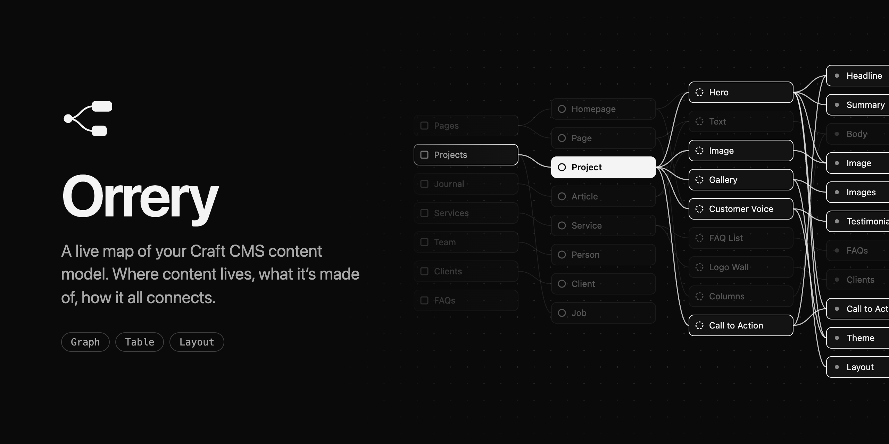
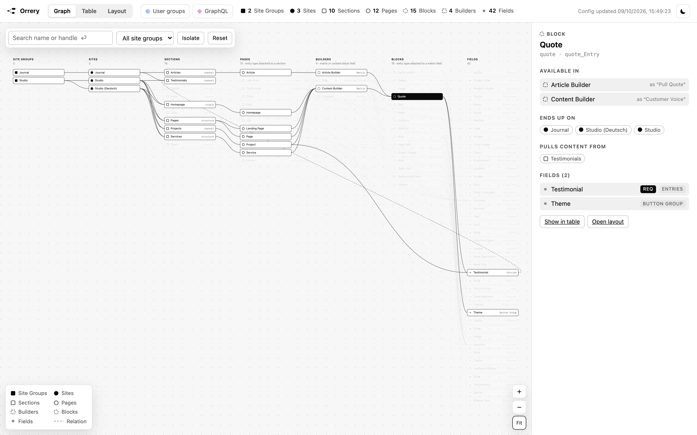
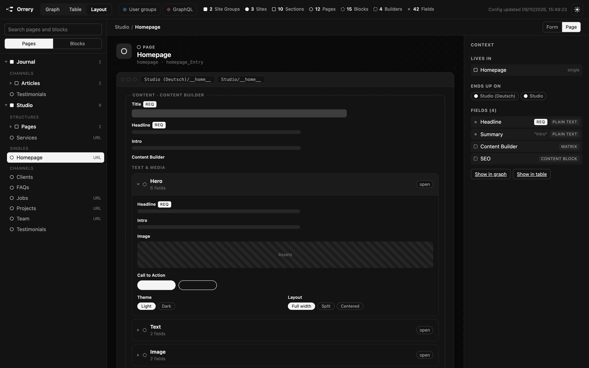

# Orrery

A live map of your Craft CMS content model: where content lives, what it’s made of, and how it all connects. Orrery reads the project config and draws it in the control panel. Nothing to build, nothing stored, no Node on the server.



## Views

- **Graph**: site groups → sites → sections → pages → builders → blocks → fields, as one pannable map. Click anything to light up what it’s connected to, or *Isolate* it to lay out only that part. Double-click zooms in like a map, Shift + double-click zooms out. Drag a node to move it and the others make room. Dashed lines are relations, where a field pulls entries from another section.
- **Table**: every field and each layout it sits in, with the label it gets there. Flip it to read every entry type with its fields. Filter by type, by site group, or to fields that aren’t used anywhere.
- **Layout**: every field layout as the editor sees the form, or drawn as a page wireframe with its builders and blocks.

### Access

Two pickers in the header switch on user groups and GraphQL schemas, one by one or all at once. Whatever they can reach gets a mark in every view, a blue dot for user groups and a pink diamond for schemas, and the details of a site, section or entry type list what each of them may do there. Open a group or schema to see all of its rights; the graph lights up everything it reaches.

User groups show which sites they may edit and what they may do with the entries of each section. Schemas show the sites, sections and Matrix fields they may query or change.

A *page* is an entry type attached to a section, a *block* one attached to a Matrix field. When a section or Matrix field gives an entry type its own name, Orrery shows that name too.

Every view has shareable links, like `#graph/page:<uid>` or `#table/field:<uid>`.



## Requirements

Craft CMS 5.0 or later, PHP 8.2 or later.

## Installation

From the Plugin Store: search for “Orrery” and press *Install*.

With Composer:

```bash
composer require davidhellmann/craft-orrery
php craft plugin/install orrery
```

## Usage

Orrery adds its own section to the control panel. Use *Fullscreen* for more room, *Open in new tab* for a page of its own, or *Download* to save the whole map as one HTML file that opens without Craft.

Users need the *Access Orrery* permission to see it.

### Export

The same file, or the raw data as JSON, from the command line:

```bash
php craft orrery/export                                # content-model.html in the current directory
php craft orrery/export @storage/content-model.json    # .json writes the data instead
```

The JSON is stable between runs, so committing it lets you review content model changes in a pull request. Mind where you write it: the export lists every section, entry type and field.

## Settings

Projects that prefix entry type handles, like `page_` and `block_`, can have Orrery flag the ones that don’t. Set the prefixes under *Settings → Plugins → Orrery*, or in `config/orrery.php`:

```php
<?php

return [
    'pageHandlePrefix' => 'page_',
    'blockHandlePrefix' => 'block_',
];
```

Leave a prefix blank to skip that check.

## Local development

Point a Craft project at a local copy with a path repository in its `composer.json`:

```json
{
    "minimum-stability": "dev",
    "prefer-stable": true,
    "repositories": [
        { "type": "path", "url": "../craft-orrery" }
    ]
}
```

Then `composer require davidhellmann/craft-orrery` and `php craft plugin/install orrery`. In the plugin folder, `composer check-cs` and `composer phpstan` run the checks.

The viewer in `src/viewer/` is plain JavaScript and CSS. Orrery inlines it into one page together with the data, so there’s no build step.

## License

MIT
